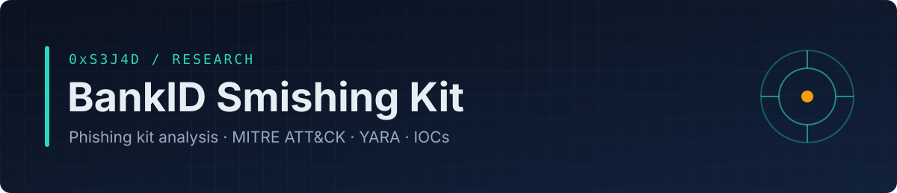
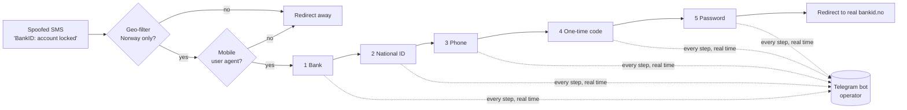

<p align="center"></p>

<p align="center"><b>Reverse engineering of a real phishing kit targeting Norwegian BankID users.<br>Bilingual report, MITRE ATT&amp;CK mapping, YARA rules and redacted IOCs.</b></p>

<p align="center">


<a href="https://github.com/0xS3J4D/phishing-analysis/actions/workflows/detection.yml"></a>

</p>

<p align="center"><b>English</b> · <a href="README.no.md">Norsk</a></p>

> **Origin:** I received this smishing SMS myself. It landed in my real BankID message thread and looked genuine, but the link said `bankld` — with an **L**, not an **i**. Instead of logging in, I pulled the kit's source (a ZIP with PHP, HTML, JS and CSS) from the link and took it apart.

Static analysis of a real phishing kit that impersonates **BankID**, Norway's national electronic ID. The kit is delivered by spoofed SMS (smishing), collects the victim's bank, national identity number, phone number, one-time code and password in five steps, and forwards **every field in real time to a Telegram bot**. That lets the operator use a live one-time code before it expires (adversary-in-the-middle).

## 📄 Report

| | English | Norsk |
|---|---|---|
| PDF | [bankid-smishing-kit-analysis-en.pdf](report/bankid-smishing-kit-analysis-en.pdf) | [bankid-smishing-kit-analysis-no.pdf](report/bankid-smishing-kit-analysis-no.pdf) |
| Read on GitHub | [report-en.md](report/src/report-en.md) | [report-no.md](report/src/report-no.md) |

## How the kit works



## Key findings

- **Lookalike domain**: `bankld` (homoglyph l/i), delivered by spoofed SMS into a real BankID thread.

- **Five-step harvesting flow**: bank → national ID (*fødselsnummer*) → phone → OTP → password. Anything typed is leaked even if the victim stops halfway.
- **Real-time Telegram exfiltration** of each field, which enables live OTP relay. No dedicated C2 server is needed.
- **Evasion**: Norway-only geo-filter, mobile-only gate, per-character DOM obfuscation, random CSS classes, `noindex`.
- **Trust tricks**: cloned BankID assets, a fake 8-second "authenticating" spinner and a final redirect to the real `bankid.no`.
- **Hardcoded secrets** (bot token, chat ID, operator handle, API key) give defenders strong pivots.
- **Dormant card-theft handler**, which points to a reusable kit family.

## MITRE ATT&CK

| Tactic | Technique |
|---|---|
| Resource Development | T1583.001 Domains · T1583.006 Web Services · T1608.005 Link Target |
| Reconnaissance | T1598.003 Spearphishing Link (for information) |
| Initial Access | T1566.002 Spearphishing Link · Mobile T1660 Phishing (SMS) |
| Defense Evasion | T1656 Impersonation · T1480 Execution Guardrails · T1027 Obfuscation |
| Credential Access / Collection | T1056.003 Web Portal Capture · T1111 MFA Interception |
| Exfiltration | T1567 Exfiltration Over Web Service |
| Impact | T1657 Financial Theft |

## Repository contents

```
├── report/
│   ├── bankid-smishing-kit-analysis-en.pdf   # full report (English)
│   ├── bankid-smishing-kit-analysis-no.pdf   # full report (Norwegian)
│   ├── src/                                   # Markdown sources
│   └── build.sh                               # rebuilds the PDFs
├── detection/                                 # YARA rules + tests (run in CI)
├── iocs/                                      # redacted IOCs (Markdown + CSV)

```

## Skills demonstrated

Phishing kit reverse engineering (PHP and JavaScript) · threat intelligence and IOC extraction · MITRE ATT&CK mapping · YARA detection engineering · responsible disclosure and redaction · technical writing in English and Norwegian.

## Ethics and scope

- Analysis was **static only**. The kit was never deployed, and no victims, banks or operator infrastructure were contacted.
- The extracted bot token was deliberately **not** used; doing so would mean using criminal credentials without authorisation.
- Secrets are redacted and domains defanged. The full IOC set is shared only with CERTs and the affected brand.
- The material describes how the attack works so that it can be detected and stopped. It is not a guide to running one.

## About the author

**0xS3J4D** — cybersecurity student interested in threat intelligence, phishing and fraud analysis, and detection engineering, with a focus on threats against Norwegian users.
GitHub: [@0xS3J4D](https://github.com/0xS3J4D)

## License

Report and documentation: [CC BY 4.0](LICENSE). Detection rules may be used freely; please give credit.

---
<p align="center"><sub>Part of <a href="https://github.com/0xS3J4D">0xS3J4D</a>'s security portfolio · for defensive and educational use</sub></p>
