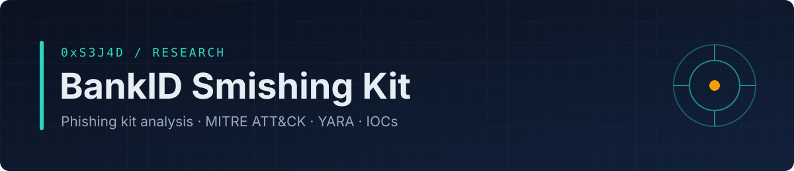
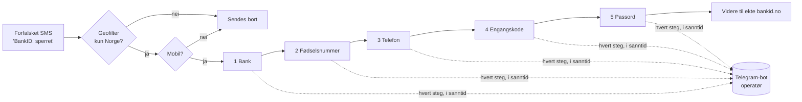

<b>Analyse av et ekte phishingkit rettet mot norske BankID-brukere. Rapport på norsk og engelsk, MITRE ATT&amp;CK, YARA-regler og sladdede IOC-er.</b>

<a href="README.md">English</a> · <b>Norsk</b>

> **Bakgrunn:** Jeg fikk denne SMS-en selv. Den havnet i den ekte BankID-tråden min og så helt ekte ut, men i lenken sto det `bankld` — med **L**, ikke **i**. I stedet for å logge inn hentet jeg kildekoden til kittet (en ZIP med PHP, HTML, JS og CSS) fra lenken og analyserte den.

Statisk analyse av et ekte phishingkit som utgir seg for å være **BankID**. Kittet spres via SMS med forfalsket avsender (smishing). I fem steg samler det inn bank, fødselsnummer, telefonnummer, engangskode og passord, og sender **hvert felt i sanntid til en Telegram-bot**. Dermed kan operatøren bruke engangskoden mens den fortsatt er gyldig.

## 📄 Rapport

| | Norsk | English |
|---|---|---|
| PDF | [bankid-smishing-kit-analysis-no.pdf](report/bankid-smishing-kit-analysis-no.pdf) | [bankid-smishing-kit-analysis-en.pdf](report/bankid-smishing-kit-analysis-en.pdf) |
| Les på GitHub | [report-no.md](report/src/report-no.md) | [report-en.md](report/src/report-en.md) |

## Slik fungerer kittet

## Hovedfunn

- **Forfalsket domene**: `bankld` (l i stedet for i), levert via falsk SMS inn i en ekte BankID-tråd.

- **Fem innsamlingssteg**. Alt som tastes inn lekker, selv om offeret avbryter halvveis.
- **Eksfiltrering i sanntid via Telegram**, som åpner for kontoovertakelse med en fersk engangskode. Det trengs ingen egen C2-server.
- **Unnvikelse**: geofilter (kun Norge), krav om mobil, tegn-for-tegn-tilsløring av sideteksten, tilfeldige CSS-klasser og `noindex`.
- **Tillitsknep**: kopierte BankID-filer, falsk lasteskjerm på 8 sekunder og videresending til ekte `bankid.no` til slutt.
- **Hardkodede hemmeligheter** (bottoken, chat-ID, brukernavn, API-nøkkel) gir forsvarere gode spor.
- **Sovende funksjon for kortdata**, som tyder på en gjenbrukbar kitfamilie.

## Innhold

- `report/`: rapport som PDF (norsk og engelsk) og Markdown-kilder
- `detection/bankid_kit.yar`: YARA-regler for å finne kittet
- `iocs/`: sladdede indikatorer (Markdown og CSV)

## Etikk og omfang

Analysen var **kun statisk**. Kittet ble aldri satt i drift, og verken ofre, banker eller operatørens infrastruktur ble kontaktet. Bottokenet ble bevisst **ikke** brukt. Hemmeligheter er sladdet, og det fullstendige IOC-settet deles bare med CERT-er og BankID.

## Om forfatteren

**0xS3J4D** er cybersikkerhetsstudent med interesse for trusseletterretning, phishing- og svindelanalyse og deteksjon, med fokus på trusler mot norske brukere. GitHub: [@0xS3J4D](https://github.com/0xS3J4D)

## Lisens

Rapport og dokumentasjon: [CC BY 4.0](LICENSE).

---

Del av <a href="https://github.com/0xS3J4D">0xS3J4D</a> sin sikkerhetsportefølje · for forsvar og læring

